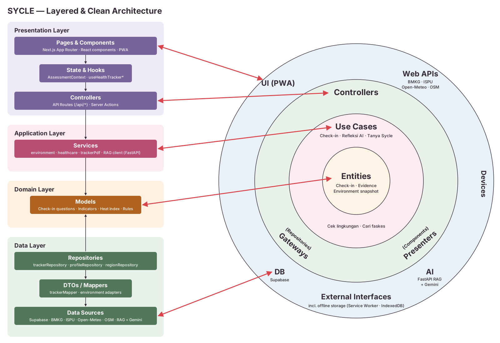

# Proyek Capstone – Perempuan Inovasi GENerasi AI

### AI Full Stack Web Development 2026

**Nama Kelompok: Martha Christina Tiahahu**

Selamat datang di repositori resmi proyek Capstone kami dalam program **Perempuan Inovasi GENerasi AI**.

Tim kami terdiri dari tiga pengembang yang mengikuti program AI Full Stack Web Development. Bersama-sama, kami mengembangkan **SYCLE**, sebuah platform digital yang mengintegrasikan kesehatan reproduksi perempuan, kesadaran lingkungan, dan kecerdasan buatan (*Artificial Intelligence/AI*).

---

## Tim Pengembang

Kenali tim di balik pengembangan SYCLE!

| Nama | Kontak |
|:---:|:---:|
| Ita Rahmatiah Mustamin | [LinkedIn](https://www.linkedin.com/in/ita-rahmatiah-mustamin-1b0868134/) · [GitHub](https://github.com/rahmatiah38-code) |
| Nurmalia | [LinkedIn](https://www.linkedin.com/in/lia-nurmalia-0a37b7208) · [GitHub](https://github.com/katanyalia) |
| Revina Chitra Sagita | [LinkedIn](https://www.linkedin.com/in/revina-chitra-s-61a71893/) · [GitHub](https://github.com/vinachitra) |

---

## Mentor

| Nama Mentor | Kontak |
|:---:|:---:|
| Andiastika Intan Pratiwi Hasan | [LinkedIn](https://www.linkedin.com/in/andiastika/) |
| Jesslyn Audrey | [LinkedIn](https://www.linkedin.com/in/jesslynaudrey) |

---

## Tentang SYCLE

**SYCLE** merupakan platform digital yang dirancang untuk membantu perempuan Indonesia memahami hubungan antara kesehatan reproduksi dan kondisi lingkungan.

Dengan mengintegrasikan data lingkungan, pelacakan kesehatan, sumber edukasi, dan informasi berbasis AI, SYCLE bertujuan menyediakan informasi yang mudah diakses, kontekstual, dan berbasis bukti untuk mendukung kesadaran perempuan terhadap kesehatannya.

SYCLE menggunakan faktor lingkungan seperti suhu, kelembapan, indeks UV, dan kualitas udara sebagai informasi kontekstual yang dapat berkaitan dengan pengalaman sehari-hari, bukan sebagai dasar diagnosis medis.

---

## Fitur Utama

| Fitur | Deskripsi |
|:---:|:---|
| **Beranda** | Menampilkan kondisi lingkungan berdasarkan lokasi pengguna, meliputi suhu, kelembapan, indeks UV, kualitas udara, dan Heat Index, serta pilihan aktivitas sehari-hari. |
| **Health Tracker** | Menyediakan check-in kesehatan terkait menstruasi, kehamilan, dan menyusui. Pengguna tamu dapat mencoba check-in hingga melihat ringkasan, sedangkan penyimpanan riwayat dan akses AI Reflection memerlukan akun. |
| **AI Reflection** | Memberikan ringkasan dan saran berbasis AI berdasarkan hasil check-in pengguna serta bukti kesehatan terkurasi SYCLE. Fitur ini tersedia bagi pengguna yang memiliki akun. |
| **Info & Edukasi** | Menyediakan artikel, glosarium, panduan perlindungan, dan referensi. Konten tertentu dapat diakses secara offline. |
| **Fasilitas Kesehatan** | Membantu pengguna menemukan fasilitas kesehatan di sekitar lokasi yang dipilih. |
| **Tanya SYCLE** | Asisten percakapan berbasis AI yang menjawab pertanyaan menggunakan sumber bukti terkurasi SYCLE. Pengguna tamu dapat mengajukan hingga tiga pertanyaan per hari. |

---

## Akses SYCLE

SYCLE dapat diakses secara langsung melalui browser maupun dipasang sebagai *Progressive Web Application* (PWA) pada perangkat yang mendukung.

| Metode Akses | Tautan |
|:---:|:---:|
| Aplikasi Web | [Buka SYCLE](https://sycle-eta.vercel.app) |

---

## Panduan Penggunaan SYCLE

SYCLE menyediakan berbagai fitur untuk membantu pengguna mengenali kondisi lingkungan, memahami kesehatan reproduksi, dan mengakses informasi edukatif berbasis bukti.

### 1. Mengakses Beranda

- Buka SYCLE melalui browser yang didukung.
- Pilih lokasi untuk mendapatkan informasi kondisi lingkungan.
- Pilih aktivitas sehari-hari sebagai konteks penilaian.
- Jelajahi indikator lingkungan yang tersedia, seperti suhu, kelembapan, indeks UV, kualitas udara, dan Heat Index.

### 2. Menggunakan Health Tracker

- Buka fitur Health Tracker.
- Pilih kondisi yang sesuai dengan keadaan pengguna.
- Isi pertanyaan yang tersedia berdasarkan kondisi masing-masing.
- Tinjau ringkasan hasil check-in.
- Masuk atau buat akun untuk menyimpan riwayat check-in dan mengakses fitur AI Reflection.

### 3. Mengakses AI Reflection

- Selesaikan dan kirim check-in melalui Health Tracker sebagai pengguna yang memiliki akun.
- Buka fitur AI Reflection.
- Pelajari ringkasan dan saran yang dihasilkan berdasarkan hasil check-in serta bukti kesehatan terkurasi SYCLE.

### 4. Menjelajahi Info & Edukasi

- Buka bagian Info & Edukasi.
- Jelajahi artikel edukasi, glosarium, panduan perlindungan, dan referensi pendukung.
- Akses konten edukasi tertentu ketika sedang offline.

### 5. Menggunakan Tanya SYCLE

- Buka fitur Tanya SYCLE.
- Masukkan pertanyaan seputar kesehatan reproduksi dan kondisi lingkungan.
- Baca jawaban yang dihasilkan AI beserta sumber bukti pendukungnya.

### 6. Menemukan Fasilitas Kesehatan

- Buka fitur Fasilitas Kesehatan.
- Pilih lokasi yang diinginkan.
- Jelajahi fasilitas kesehatan di sekitar lokasi tersebut.

---

## Tutorial Instalasi PWA

SYCLE dapat dipasang sebagai *Progressive Web Application* (PWA) pada perangkat yang mendukung. Dengan demikian, pengguna dapat mengakses aplikasi dengan lebih mudah melalui layar utama perangkat atau desktop.

Untuk melihat langkah-langkah instalasi SYCLE pada Android, iOS, dan desktop, silakan kunjungi tutorial berikut:

**[Tonton Tutorial Instalasi PWA](https://drive.google.com/file/d/1ewwTdAyKrL_JXyUeo8hecBPk0jPAyjz2/view?usp=sharing)**

---

## Arsitektur Sistem

SYCLE dikembangkan sebagai aplikasi web *full-stack* dengan sistem pencarian dan pengambilan informasi berbasis AI yang terintegrasi.

### Teknologi Utama

- **Frontend:** Next.js dan React.js (Progressive Web Application)
- **Backend:** Next.js Server Actions / API Routes dan FastAPI
- **Database & Autentikasi:** Supabase
- **Integrasi AI:** Retrieval-Augmented Generation (RAG) dengan Google Gemini
- **Data Lingkungan:** BMKG, KLH/BPLH (ISPU), dan Open-Meteo
- **Data Fasilitas Kesehatan:** OpenStreetMap

### Teknologi Deployment

- **Frontend (Next.js PWA):** Vercel
- **Backend (Layanan FastAPI RAG):** Railway

### Diagram Arsitektur SYCLE

---

## Dokumentasi AI & RAG

SYCLE mengintegrasikan sistem **Retrieval-Augmented Generation (RAG)** untuk menghasilkan jawaban yang kontekstual, relevan, dan berbasis bukti terkait kesehatan reproduksi perempuan serta kondisi lingkungan.

Pipeline RAG menggunakan pendekatan **Hybrid Retrieval**, yaitu menggabungkan pencarian berbasis kata kunci dan pencarian semantik untuk meningkatkan relevansi informasi yang ditemukan.

### Teknologi yang Digunakan dalam RAG

| Komponen | Teknologi / Metode |
|:---:|:---:|
| Kerangka RAG | Custom RAG Pipeline |
| Model Embedding | `intfloat/multilingual-e5-small` |
| Model Bahasa | Google Gemini (`GEMINI_MODEL`, dengan fallback `gemini-3.1-flash-lite` dan `gemini-2.5-flash-lite`) |
| Basis Data Vektor | Supabase |
| Pencarian Kata Kunci | BM25 |
| Pencarian Semantik | Vector Similarity Search |
| Strategi Retrieval | Hybrid Retrieval |
| Penggabungan Hasil | Reciprocal Rank Fusion (RRF) |

### Alur Hybrid Retrieval

1. **BM25 Retrieval:** Menemukan bukti yang relevan berdasarkan kecocokan kata kunci.
2. **Vector Similarity Search:** Mengambil bukti yang relevan secara semantik menggunakan kemiripan embedding.
3. **Reciprocal Rank Fusion (RRF):** Menggabungkan dan mengurutkan hasil dari kedua metode pencarian.
4. **Context Generation:** Menyediakan bukti yang telah ditemukan sebagai konteks bagi AI untuk menghasilkan jawaban.

Pendekatan hybrid ini membantu SYCLE menemukan informasi yang relevan melalui pencocokan kata kunci secara langsung maupun pemahaman semantik.

---

## Dataset & Sumber Data

SYCLE menggunakan berbagai sumber data lingkungan dan edukasi untuk menyediakan informasi yang kontekstual.

| Sumber Data | Kegunaan |
|:---:|:---|
| BMKG | Informasi prakiraan cuaca, termasuk suhu dan kelembapan. |
| KLH/BPLH | Informasi kualitas udara (ISPU) dari stasiun pemantauan. |
| Open-Meteo | Indeks UV, data cuaca sebagai alternatif, dan US AQI (*Air Quality API*) sebagai sumber alternatif ketika data ISPU tidak tersedia. |
| Rumus Heat Index NOAA | Perhitungan Heat Index berdasarkan suhu dan kelembapan relatif. |
| OpenStreetMap | Data fasilitas kesehatan, termasuk snapshot offline, dan nama lokasi melalui Nominatim. |
| Dokumen Evidence | Materi edukasi kesehatan reproduksi dan referensi pendukung yang digunakan oleh sistem RAG. |

---

## Desain UI/UX

| Desain & Prototipe | Tautan |
|:---:|:---:|
| Desain UI/UX (Figma) | [Lihat Desain](https://verify-pry-64828530.figma.site) |

---

## Deployment

SYCLE telah di-deploy sebagai *Progressive Web Application* (PWA), sehingga pengguna dapat mengakses platform melalui browser yang didukung dan memasangnya pada perangkat yang kompatibel.

**Tautan Aplikasi:** [Buka SYCLE](https://sycle-eta.vercel.app)

---

## Repositori Proyek

| Branch | Deskripsi | Tautan |
|:---:|:---|:---:|
| `main` | Branch utama yang berisi versi SYCLE yang stabil dan terintegrasi. | [Lihat Branch](https://github.com/katanyalia/Sycle_LCH_PI/tree/main) |
| `demo-gabungan` | Branch pengembangan untuk proses pengembangan, integrasi fitur, dan pengujian. | [Lihat Branch](https://github.com/katanyalia/Sycle_LCH_PI/tree/demo-gabungan) |